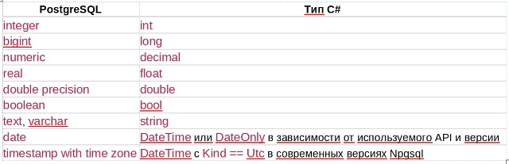

# три способа выполнение команды

1) ExecuteReader - возвращает набор сторок и столбоц (npgsqldataReader)
2) ExecuteNonQuery - команда измменяет данные и не должна возращять набор строк, возращяет число затронутых строк
3) ExecuteScalar - нужен один результат, применяеться когда нужен результат: одна строка и один столбец, взращяет значение первой колонки, первой строки или null(если результата нет)

в этих методом есть ансихронные версии с суффиксом Async(например: ExecuteReaderAsync, ExecuteNonQueryAsync, ExecuteScalarAsync)

## типы данных
postsql - строго типизированная СУБД. напрмер  integer, varchar, text, и так далее это все отдельные типы.
npgsql сопостявляет ado.net типы с типами postgres.
обычно драйвер вывод тип параметра из тпа значение c#, но в не однозначных ситуациях тип стоит указать явным
- 

### примеры: 

```csharp
    //подсчет клиентов
    string sql = """
    select count(*) 
    from clients;
    """;

    using var command = new NpgsqlCommand(sql, _connection);
    object? result = command.ExecuteScalar();
    Console.WriteLine($"Всего клиентов: {Convert.ToInt64(result)}");

```