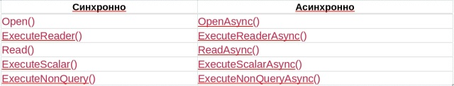

# три способа выполнение команды

1) ExecuteReader - возвращает набор сторок и столбоц (npgsqldataReader)
2) ExecuteNonQuery - команда измменяет данные и не должна возращять набор строк, возращяет число затронутых строк
3) ExecuteScalar - нужен один результат, применяеться когда нужен результат: одна строка и один столбец, взращяет значение первой колонки, первой строки или null(если результата нет)

в этих методом есть ансихронные версии с суффиксом Async(например: ExecuteReaderAsync, ExecuteNonQueryAsync, ExecuteScalarAsync)

## типы данных
postsql - строго типизированная СУБД. напрмер  integer, varchar, text, и так далее это все отдельные типы.
npgsql сопостявляет ado.net типы с типами postgres.
обычно драйвер вывод тип параметра из тпа значение c#, но в не однозначных ситуациях тип стоит указать явным
- 

### примеры: 

```csharp
    //подсчет клиентов
    string sql = """
    select count(*) 
    from clients;
    """;

    using var command = new NpgsqlCommand(sql, _connection);
    object? result = command.ExecuteScalar();
    Console.WriteLine($"Всего клиентов: {Convert.ToInt64(result)}");

```


## транзакции, комит и роллбэк

транзакции обеденяет несколько операции в бд, в одну логическую единицу. либо все потверждение потверждаються либо все изменение отменяються.
пример: перевод денег между счетами 
если деньги списаль со счета А, но не зачислильсь на счет Б, то состояние системы испорчено. обе части должны быть общей одной транзакции. 

ACID - 4 свойства транзакции:
- Atomicity — атомарность: все операции выполняються вместе либо не принимаються вообще.
- Consistency — согласованность: транзакция сохраняет устоновление правила и ограничение данных.
- Isolation — изолированность: паралельные транзакции не должны создавать запрещеные существующие эффекты, конкретные гарантии зависят от уровня изоляции.
- Durability — надежность фиксации: зафиксированые изменение должны сохраняться согласно СУБД.


## асинхронный ado.net

обращение к бд требует сетевого подключение: приложение отправляет запрос и ждет от него ответа.
асихронный метод позволяет потоку ado.net не простаивать в ожидание ответа, а обслуживать другую работу.
асинхрость сама по себе не гранантирует, что sql не станет быстрее. она особенно полезна в веб серверах, графических приложениях, и программах, который к обращению бд должны оставаться отзывчивыми.





```csharp
using Npgsql;

string connectionString = Environment.GetEnvironmentVariable("FITNESS_DB")
    ?? throw new InvalidOperationException("Не задана переменная FITNESS_DB.");

await using var dataSource = NpgsqlDataSource.Create(connectionString);

await using var command = dataSource.CreateCommand("""
    SELECT client_id, first_name, last_name
    FROM clients
    ORDER BY client_id;
    """);

await using var reader = await command.ExecuteReaderAsync();

while (await reader.ReadAsync())
{
    int id = reader.GetInt32(0);
    string firstName = reader.GetString(1);
    string lastName = reader.GetString(2);
    Console.WriteLine($"{id}: {firstName} {lastName}");
}
В современном C# можно использовать await на верхнем уровне программы (Program.cs) в консольном проекте. Если проект создан на старой версии C#/.NET, разместите код внутри static async Task Main().
```


## передача cancellationtoken

токен отмены запросить прекращение работы. например если пользователь закрыл окно или клиент отменить http запрос.
отмена со стороны приложение не озночает, что любая операция на сервере мнгоновенно остановиться. поведение зависит от состояние запроса, драйвера и сервера.


## класс доступа к данным и патерн к repository

когда приложние находитться в main, там одновреммено оказываеться ввод пользователя, sql, преобразрование, бизнес правила и вывод.
по мере роста проекта такой код сложно понимать и изменять. 
раздение отвестености: 
1) точка входа\интерфеис - получает ввод и показывает результат.
2) класс доступа к данным - знает sql и способы чтение и измениение данных.
3) модель - описывает данных клиентов в c#.
4) бизнес логика - отделяет правила: например, можно ли регистровать клиента с определлыем статусом, и так далее.

repository - распростренненый способ скрыть детали получение и сохранение данных из набора матодов.
например: getallAsync, GetByIdAsync, etc...


```csharp
   using Npgsql;

public sealed class ClientRepository
{
    private readonly NpgsqlDataSource _dataSource;

    public ClientRepository(NpgsqlDataSource dataSource)
    {
        _dataSource = dataSource;
    }

    public async Task<List<Client>> GetAllAsync(
        CancellationToken cancellationToken = default)
    {
        var clients = new List<Client>();

        await using var command = _dataSource.CreateCommand("""
            SELECT client_id, first_name, last_name, phone, email, status
            FROM clients
            ORDER BY client_id;
            """);

        await using var reader = await command.ExecuteReaderAsync(cancellationToken);

        while (await reader.ReadAsync(cancellationToken))
            clients.Add(MapClient(reader));

        return clients;
    }

    public async Task<Client?> GetByIdAsync(
        int clientId,
        CancellationToken cancellationToken = default)
    {
        await using var command = _dataSource.CreateCommand("""
            SELECT client_id, first_name, last_name, phone, email, status
            FROM clients
            WHERE client_id = $1;
            """);
        command.Parameters.AddWithValue(clientId);

        await using var reader = await command.ExecuteReaderAsync(cancellationToken);
        if (!await reader.ReadAsync(cancellationToken))
            return null;

        return MapClient(reader);
    }

    public async Task<int> CreateAsync(
        string firstName,
        string lastName,
        string? phone,
        string? email,
        CancellationToken cancellationToken = default)
    {
        if (string.IsNullOrWhiteSpace(firstName))
            throw new ArgumentException("Имя обязательно.", nameof(firstName));
        if (string.IsNullOrWhiteSpace(lastName))
            throw new ArgumentException("Фамилия обязательна.", nameof(lastName));

        await using var command = _dataSource.CreateCommand("""
            INSERT INTO clients
                (first_name, last_name, phone, email, registration_date, status)
            VALUES
                ($1, $2, $3, $4, CURRENT_DATE, $5)
            RETURNING client_id;
            """);

        command.Parameters.AddWithValue(firstName.Trim());
        command.Parameters.AddWithValue(lastName.Trim());
        command.Parameters.AddWithValue((object?)phone ?? DBNull.Value);
        command.Parameters.AddWithValue((object?)email ?? DBNull.Value);
        command.Parameters.AddWithValue("active");

        object? result = await command.ExecuteScalarAsync(cancellationToken);
        return Convert.ToInt32(result);
    }

    public async Task<bool> UpdatePhoneAsync(
        int clientId,
        string? phone,
        CancellationToken cancellationToken = default)
    {
        await using var command = _dataSource.CreateCommand("""
            UPDATE clients
            SET phone = $1
            WHERE client_id = $2;
            """);

        command.Parameters.AddWithValue((object?)phone ?? DBNull.Value);
        command.Parameters.AddWithValue(clientId);

        int changedRows = await command.ExecuteNonQueryAsync(cancellationToken);
        return changedRows == 1;
    }

    public async Task<bool> DeleteAsync(
        int clientId,
        CancellationToken cancellationToken = default)
    {
        await using var command = _dataSource.CreateCommand("""
            DELETE FROM clients
            WHERE client_id = $1;
            """);
        command.Parameters.AddWithValue(clientId);

        int deletedRows = await command.ExecuteNonQueryAsync(cancellationToken);
        return deletedRows == 1;
    }

    private static Client MapClient(NpgsqlDataReader reader)
    {
        return new Client
        {
            ClientId = reader.GetInt32(0),
            FirstName = reader.GetString(1),
            LastName = reader.GetString(2),
            Phone = reader.IsDBNull(3) ? null : reader.GetString(3),
            Email = reader.IsDBNull(4) ? null : reader.GetString(4),
            Status = reader.GetString(5)
        };
    }
} 
```